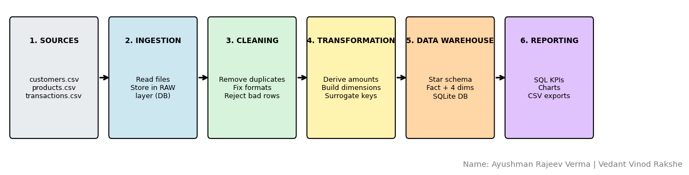

# Data Engineering Practicals

Practical journal and source code for the **Data Engineering** subject, B. K. Birla College, Kalyan.

| | |
|---|---|
| **Name** | Aayushman Rajeev Verma |
| **Roll No.** | 57 |
| **Student ID** | 5176202 |
| **College** | B. K. Birla College, Kalyan |
| **Subject** | Data Engineering |

The complete written journal (aim, steps, code and output for all 10 practicals) is in the [`journal/`](journal/) folder as a Word file and a PDF.

## Practicals

| No. | Practical | Tools | Files |
|----|-----------|-------|-------|
| 1 | Parsing text, CSV, HTML, XML, JSON and binary files, regular expressions, SQL CRUD | Python, Pandas, lxml, struct, re, SQLite | [practical-01-employee-data-parsing](practical-01-employee-data-parsing/) |
| 2 | ETL process in Power BI (extract, transform, load) | Power BI, Power Query | [practical-02-powerbi-bookstore-etl](practical-02-powerbi-bookstore-etl/) |
| 3 | MongoDB single and multiple document insertion and retrieval | MongoDB, mongosh | [practical-03-mongodb](practical-03-mongodb/) |
| 4 | Data preprocessing, noise elimination, feature selection and EDA | Pandas, NumPy, Scikit-learn, Matplotlib, Seaborn | [practical-04-housing-preprocessing-eda](practical-04-housing-preprocessing-eda/) |
| 5 | Extracting data from a REST API and a CSV file into one clean report | Python, requests, Pandas | [practical-05-extract-pipeline](practical-05-extract-pipeline/) |
| 6 | Apache Airflow DAG scheduled daily at 06:00 with five dependent tasks | Apache Airflow | [practical-06-airflow-dag](practical-06-airflow-dag/) |
| 7 | ETL pipelines with validation, rejected records and incremental (watermark) loading | Pandas, SQLite | [practical-07-payroll-etl](practical-07-payroll-etl/) |
| 8 | Distributed processing with PySpark DataFrames and Spark SQL | PySpark | [practical-08-pyspark-employees](practical-08-pyspark-employees/) |
| 9 | End-to-end e-commerce pipelines for historical and newly arriving data | Pandas, SQLite, Matplotlib | [practical-09-ecommerce-pipelines](practical-09-ecommerce-pipelines/) |
| 10 | Mini project: retail sales data warehouse (star schema) | Pandas, SQLite, Matplotlib | [practical-10-retail-data-warehouse](practical-10-retail-data-warehouse/) |

### Practical 10 (group project)

Done with **Vedant Vinod Rakshe** (Roll No. 37, Student ID 5176220). The pipeline ingests raw CSV files, cleans them with five quality rules, builds a star schema (one fact table and four dimensions) in SQLite and produces KPI reports and a dashboard.



## Repository structure

```
data-engineering-practicals/
├── README.md
├── requirements.txt
├── .gitignore
├── journal/                         # full practical journal (.docx and .pdf)
├── practical-01-employee-data-parsing/
├── practical-02-powerbi-bookstore-etl/
├── practical-03-mongodb/
├── practical-04-housing-preprocessing-eda/
├── practical-05-extract-pipeline/
├── practical-06-airflow-dag/
├── practical-07-payroll-etl/
├── practical-08-pyspark-employees/
├── practical-09-ecommerce-pipelines/
└── practical-10-retail-data-warehouse/
```

## How to run

1. Install Python 3.10 or newer, then clone the repository and install the libraries:

   ```bash
   git clone https://github.com/<your-username>/data-engineering-practicals.git
   cd data-engineering-practicals
   pip install -r requirements.txt
   ```

2. Open any notebook with Jupyter (`jupyter notebook`) or upload it to Google Colab and use **Run all**.
   Each notebook creates its own sample input files, so no extra data download is needed.

3. Stand-alone scripts:

   ```bash
   python practical-05-extract-pipeline/extract_pipeline.py
   python practical-10-retail-data-warehouse/practical_10_group_project_retail_dw.py
   ```

### Notes

- **Practical 2** needs Power BI Desktop (Windows) to open the `.pbix` file. The PDF contains the step-by-step screenshots. The workbook used is the Northwind sample data (Products, Orders, Order_Details).
- **Practical 3** needs MongoDB and mongosh. The commands are in `mongodb_commands.js` and the output screenshots are in the PDF.
- **Practical 6** needs Linux, macOS, WSL2 or Google Colab. Copy `api_csv_daily_pipeline.py` to `~/airflow/dags/` and `extract_pipeline.py` to `~/airflow/scripts/`, then run `airflow standalone` and open http://localhost:8080.
- **Practical 8** needs Java (already available on Google Colab) in addition to `pyspark`.
- **Practical 5** uses the public API https://jsonplaceholder.typicode.com/todos and falls back to a cached sample if the API cannot be reached.

## Author

Aayushman Rajeev Verma, Roll No. 57, B. K. Birla College, Kalyan.
